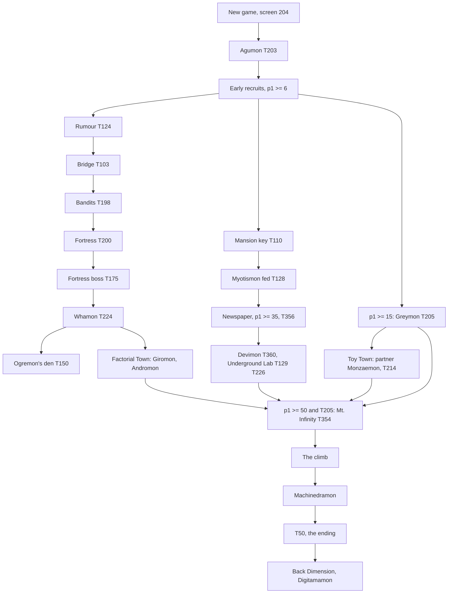

# Story engine

How the story works underneath the story language: where the engine enters a script, the hidden calling convention
between scripts and C, the state the story reads and writes, what is C rather than script, how the original quest chain
and zone gates are built, how `story/base` and the mods become `DG.SCN` and `MAPHEAD.SCN`, the EXTENDED STORY copies,
and the engine patches the story layer depends on.

What is documented elsewhere and not repeated here:

| Topic | Where |
|---|---|
| Writing story in Python (the surface language, handlers, guards, quests, text) | [../mods/story-language.md](../mods/story-language.md) |
| DWS: scopes and pools, flag allocation and `story.lock`, overrides and patches of a section, how the back end patches sections, `place`, new scripts | [../mods/dws.md](../mods/dws.md) |
| The C city rules as data (prosperity, top map, revival screen, start state, overlay lists) and NPC presence | [../mods/city-rules.md](../mods/city-rules.md) |
| Compiler-emitted bytecode: containers, text controls, growth and round-trip checks | [../mods/scripts.md](../mods/scripts.md) |
| The EXTENDED STORY option as the player sees it | [../mods/options.md](../mods/options.md) |
| Rules that were C and are now `content/tables` data (evolution, medals, tamer level, care, clock, new game...) | [../mods/balance.md](../mods/balance.md), [../mods/data-sources.md](../mods/data-sources.md) |
| Interpreter internals, RAM addresses, save layout | [scripts.md](scripts.md), [ram-map.md](ram-map.md), [memory.md](memory.md), [save-format.md](save-format.md) |
| Testing the story in the emulator | [../developing.md](../developing.md) |

The numbers below (counts of instructions, sections, uses) are measured on the US disc's scripts with
`tools/dws/bytecode/__init__.py dis`.

## 1. The story on the disc

| What | Where | Size |
|---|---|---|
| Screen scripts | `DG.SCN`, entries 1-221 (entry 0 is a copy of MAPHEAD that the game never reads: `getScript(0)` returns the MAPHEAD buffer) | 804 864 bytes, about 511 KB of content |
| Screen setups and global entry points | `MAPHEAD.SCN`, 281 sections: one per screen, numbered by screen id, plus the global entries 1220-1253 | 24 686 bytes in a 25 000-byte buffer on the original executable |
| Instructions | both | 36 365 (32 933 in `DG.SCN`, 3 432 in MAPHEAD), 79 distinct opcodes of the 80 the interpreter knows |
| Sections | both | 1 553 (1 272 + 281) |
| Dialogue | both | 4 327 boxes, 330 menus, 9 115 text rows: about 75 % of all script bytes (the code is about 130 KB) |
| Battles started by script | `DG.SCN` | 499 `START_BATTLE` in 119 scripts |
| Screen changes by script | both | 723 `WARP_TO` |
| Triggers used | scripts | 532 of 800 |
| Pstats used | scripts | 64 of 256 |
| Library scripts (no screen loads them; reached with `JUMP_TO_FILE`) | 199-221 | 23 scripts, 54 call links |
| Shared scripts | one script may serve several screens: script 5 serves 8; scripts 162/163 serve every File City variant | 254 screens use 197 scripts |
| Largest | script 18 (Amida Forest) by instructions (1 057); script 214 by bytes (12 642) | limit 16 384 bytes per script |

Fourteen opcodes are implemented but never used by the original scripts: `JUMP_TO_FILE_AND_LINK`, `REDUCE_PSTAT`,
`STORE_MAP_ID`, `COMPARE_DATE`, `SET_MERIT`, `ADD_MERIT`, `REDUCE_MERIT`, `ADD_MINUTES_TO_DATE_AT_2`,
`RESET_ENTITY_ORIGIN`, `STOP_BGM`, `ENTITY_MOVE_TO_ENTITY`, `ENTITY_MOVE_TO_WITH_CAMERA`,
`ENTITY_MOVE_TO_ENTITY_WITH_CAMERA`, `SPAWN_SPRITE_AT_LOCATION`. New content that uses them is the first to exercise them.

### Share of the instruction set

| Group | Share | Main opcodes (count) |
|---|---|---|
| Dialogue | 25.3 % | `SHOW_TEXTBOX` 4 327, `SET_DIALOG_OWNER` 3 607, `FADEOUT_HUD` 560 (closes the box), `SET_SELECTION` 330 / `END_SELECTION` 307 |
| Flow | 27.7 % | `JUMP_TO` 3 252, `IF` 2 985, `END_SECTION` 2 811, `JUMP_AND_LINK` 136, `JUMP_TO_FILE` 135, `SWITCH` 6, `DATA` 240, `SET_SCRIPT` 255 (MAPHEAD only), `SECTION_ON_EXIT` 4 |
| State | 11.2 % | `SET_PSTAT` 1 801, `SET_TRIGGER` 1 146, `ADD_TO_PSTAT` 272, `UNSET_TRIGGER` 227, `STORE_RANDOM` 466, `STORE_DATE` 110, `STORE_DIGIMON_TYPE` 39 |
| Motion and camera | 8.8 % | `PLAY_ANIMATION` 850, `ENTITY_LOOK_AT_ENTITY` 607, `ENTITY_WALK_TO` 547, `ENTITY_SET_ROTATION` 336, `MOVE_OBJECT_TO` 293, `MOVE_CAMERA_TO_ENTITY` 158 |
| Entities | 6.1 % | `WAIT_FOR_ENTITY` 806, `SET_DIGIMON` 756, `LOAD_DIGIMON` 502, `UNLOAD_ENTITY` 119 |
| World objects | 5.5 % | `SET_OBJ_VISIBILITY` 1 669, `SPAWN_ITEM` 241, `SPAWN_CHEST` 71 |
| Clock | 5.1 % | `DELAY` 1 817, `ADVANCE_TO_DATE_AT` 17, `ADD_MINUTES_TO_DATE_AT` 17 |
| Audio | 2.1 % | `PLAY_SOUND` 496, `SET_BGM` 266 (261 in MAPHEAD) |
| Screen change | 2.0 % | `WARP_TO` 723 |
| Engine routines | 1.9 % | `CALL_ROUTINE` 674 (50 of the 57 numbers) |
| Inventory and rewards | 1.7 % | `GIVE_ITEM` 255, `LEARN_MOVE` 118, `GIVE_CARD` 67, `REMOVE_ITEM` 63, `ADD_MONEY` 54, `REDUCE_MONEY` 57 |
| Partner | 1.4 % | `ADD_STAT` 292, `SET_STAT` 71, `CALL_DIGIMON_ROUTINE` 55, `REDUCE_STAT` 54, `DEAL_DAMAGE` 32 |
| Battle | 1.4 % | `START_BATTLE` 499 |

`IF` clauses in use: pstat comparison 2 040, trigger 1 469 (plus 540 negated), item 56, money 46, partner condition
bits 35, stat 27 (mostly stats 8, 9 and 21), card 6, known move 4. No original script compares a date directly: the clock
is copied with `STORE_DATE` into four pstats and those are compared.

Blocking: dialogue boxes, `DELAY`, `WAIT_FOR_ENTITY`, `WARP_TO`, `START_BATTLE`, `CALL_DIGIMON_ROUTINE` and most
`CALL_ROUTINE`s hold the script until they finish. Starting a walk or a camera move does not; `WAIT_FOR_ENTITY` waits for
it. The movement system has 22 slots (10 entities, the camera, a door, 10 objects), reset at each section call.

## 2. How the engine enters a script

There is no timer, no per-frame hook and no general event system. Time-dependent behaviour is decided when a screen loads
or when the player acts (`STORE_DATE` then `IF` on the hour or day). Everything a script does starts from one of these
entries:

| Entry | Who calls it (`decomp/src`) | Section | What runs there |
|---|---|---|---|
| Screen load | `changeMap`, then `runMapHeadScript(screen)` (`map.c`) | MAPHEAD section = screen id | `SET_SCRIPT` (loads the screen's script and `.MAP`), music, `LOAD_DIGIMON`/`SET_DIGIMON` (who stands on the screen, by hour and flags) |
| After the load | `returnFromScriptFile` (type 3) | section 254 of the screen script | ground items (`STORE_RANDOM` then `SPAWN_ITEM`), chests, object visibility |
| Talk to or touch an NPC | `checkMapInteraction` (`tamer.c`), `NPCEntityTick` (`overworld.c`) | 5 + slot | slots 0-7 of the screen's `SET_DIGIMON`; an `autotalk` NPC fires on touch |
| Step on a tile | `tamer.c` | 51-79 | the tile value in the `.MAP` collision grid is the section number |
| Press CROSS on a tile | `tamer.c` | 80-109 | same |
| Exits | `tamer.c` | 110-119 | resolved by C from `MAP_WARPS`; no script runs |
| Toilet | `tamer.c` | MAPHEAD 1250 (0x4E2) | |
| Global scenes called by C | `callScriptSection(0, n, ...)` | MAPHEAD 1220-1253 (0x4C4-0x4E5), below | |
| From a script | `JUMP_TO_FILE`, `JUMP_AND_LINK`, `WARP_TO screen, exit, section`, `SECTION_ON_EXIT` | any | 135 + 136 + 723 + 4 uses |

A tile section that does not change the screen runs again on every frame while the tamer stands on its tile.

Section ids are u16 in the section directory and in `callScriptSection`; only some operands (`WARP_TO16`) hold a u8. A
section a script does not have returns a null pointer in the original `getScriptSection`, which every caller then ran as
code; patch 0112 returns an `END_SECTION` instead (section 9).

### The global entry points in MAPHEAD

| Section | Hex | Called from | What it is |
|---|---|---|---|
| 1220-1229 | 0x4C4-0x4CD | `script_common.c` (`SHOPKEEP_DIGIMON_TYPES`) | the shopkeeper's lines, one section per shopkeeper species (11 species); 1220-1230 are jump tables that run on into the next section |
| 1238 | 0x4D6 | `newGameStateMachine` (`script_menu.c`) | Jijimon's new-game dialogue and naming (entries 0x10-0x39); the seven-question loop is C |
| 1240-1242 | 0x4D8-0x4DA | `tournament.c`, `utils2.c` | tournament text and the registration reminders |
| 1243 | 0x4DB | `tournament.c` | medals |
| 1245 | 0x4DD | `item.c` (Auto Pilot) | the only item that calls a script: chooses the File City screen to fly to |
| 1246 | 0x4DE | `partner_impl.c` | partner death and defeat: the tamer wakes in Jijimon's house |
| 1250 | 0x4E2 | `tamer.c` | the toilet |
| 1252 | 0x4E4 | | enters the Seadramon fishing scene (script 7 section 82) |
| others in the range | | `script_common.c`, `script_menu.c` | card shop, merit shop, Item Keeper, jukebox, Birdramon, Mojyamon |

## 3. The hidden calling convention

The original passes arguments and results through global pstats and a few triggers. The names below are in
`story/core/engine.dws` (`engine.arg`, `engine.result`, `engine.cutscene`...), and the Python surface hides them behind
typed commands.

| Register | Role |
|---|---|
| p254 | argument of a routine; the item chosen in the item picker (0xFF = nothing); the shopkeeper NPC of a shop menu |
| p255 | result of a battle (won, lost, fled) or of a tournament |
| p250-p253 | battle setup: p250 = 1 for a predefined battle, p251-p253 = the script entity ids of the foes (255 = none) |
| p249 | menu result |
| p247, p248 | teleport target; object and animation for the object-animation routine |
| p243:p244 | the 16-bit shop variable (`{shopvar}` in 126 text rows) |
| p245 | music mode (0 = automatic day/night variant) |
| p105-p108 | `STORE_DATE` target: year, day, hour, minute |
| p110 | random scratch (`STORE_RANDOM`) |
| p101 | loop counter of the walk-and-look-back idiom |
| trigger 0 | set when a given item did not fit in the inventory |
| trigger 1 | the next battle cannot be fled |
| trigger 3 | item-picker mode ("choosing an item to give"); still set after `CALL_ROUTINE 0` means the menu never opened |
| trigger 44 | scene mode: NPC and tamer do not turn to face each other; consumed at the first pause, so it does nothing in a screen's enter code |
| trigger 49 | the current menu cannot be cancelled |

Magic entity ids: 0xFD the tamer, 0xFC the partner, 5-12 the NPCs of slots 0-7, 0xC8 and up special speakers, 255 no
speaker (the narrator). `WAIT_FOR_ENTITY` also takes 200 (the camera), 201, 213, 214 (effect synchronisation) and 255 (all).

About 456 of the 674 `CALL_ROUTINE`s are preceded by an argument write, and about 25 of the 35 library entry points read
pstats they never set (p254, p123, p27...): a library call has a signature that only the caller's pstat writes show.

### Engine routines (`CALL_ROUTINE n`)

A C `switch` of 57 handlers (0x00-0x38) in `script_interp.c`; arguments and results in the pstats above.

| Role | Routines (hex) | Notes |
|---|---|---|
| Item picker and consumption | 0x00 choose an item, 0x0C remove one of p254, 0x0D remove all | the interface most quests use |
| Shops and menus | 0x01 merit shop, 0x02 Mojyamon, 0x08 shop/recycle, 0x09 jukebox, 0x0A Birdramon, 0x0B Item Keeper, 0x0E cards, 0x0F/0x10 boxes, 0x23 load the shop library | p254 = shopkeeper NPC, trigger 3 = mode |
| Tournament and training | 0x06 start a tournament, 0x12 calendar, 0x16 medal check, 0x21 the Beetle Cup registration, 0x07 training, 0x27 load the gym | results in p255 |
| Partner life | 0x1D egg choice at rebirth, 0x2F forget moves after the last life | |
| New game and save | 0x20 naming and Jijimon's intro, 0x30 the save machine, 0x36 the game-clear save | |
| Ending | 0x33 load the boss assets, 0x28 boss build-up, 0x34 load the ending, 0x35 start the ending | |
| Cutscene helpers | 0x15 object animation, 0x17/0x18 chest tray, 0x2D/0x2E fade to and from white, 0x22 Meramon's shake, 0x26 Ninjamon's effect, 0x25 remove fog, 0x1C Monochromon's mood bubble, 0x37 loop once | blocking and timing are part of the scene |
| Local map machinery | 0x13, 0x14, 0x1A, 0x1B (Drill Tunnel dirt), 0x29-0x2C (Toy Town), 0x31, 0x32 (Angemon's pedestal) | each used by one area |
| Variables | 0x19 clock speed, 0x1E/0x1F/0x38 the shop variable | |
| Reserved | 0x03, 0x04, 0x05, 0x11 | no-ops |

`CALL_DIGIMON_ROUTINE n` (`partner.c`): 0 toilet, 1 curling (parameters p121, p122), 2 revert Sukamon, 3-4 dying,
5 opening, 6 ending, 7 death by sickness, 8 Machinedramon appears, 9 death in battle, 10 forced evolution.

Several `CALL_ROUTINE`-type operations push the script call stack themselves, so the depth left for `JUMP_AND_LINK` is
less than 8 inside menus.

## 4. The state the story reads and writes

`SCRIPT_STATE` is 668 bytes: 212 bytes of shop stock and Item Keeper counts, 66 card nibbles, 800 trigger bits, 256 pstat
bytes and an 8-entry call stack. The save copies its first 0x17C bytes: every trigger, and only pstats 0-34. Addresses are
in [ram-map.md](ram-map.md); the original executable and the GCC build order the buffers differently. In the GCC build the
order is `SCRIPT_STATE`, `MAP_SCRIPT_BUFFER` (0x4000), `SCRIPT_OFFSET_TABLE`, `MAPHEAD_SCRIPT_BUFFER`, so a script over
16 KB overwrites the offset table, not the state.

| State | Size | Saved | Notes |
|---|---|---|---|
| Triggers | 800 bits | all | several ranges are per-id bitsets (below) |
| Pstats | 256 u8, saturating | 0-34 only | also the argument and result registers of commands |
| Wide registers `w0`-`w63` (mod executable) | u16 | `w0`-`w15` | [../mods/scripts.md](../mods/scripts.md) "Wide opcodes" |
| Money, merit, tournament counters | s32, s16, s16 x 5 | yes | read by `IF money`, `{money}`, tournament text |
| Inventory, cards, moves, partner stats | engine | yes | read by `IF item/card/move/stat/cond` |
| Clock | engine | yes | 20 logic frames = 1 game minute |

Trigger ranges as the scripts and the C code use them:

| Range | Used / size | What |
|---|---|---|
| 0-4, 44, 49 | engine flags | item did not fit, no escape, battle without the tamer, item-picker mode, scene mode, menu cannot be cancelled |
| 5-36 | 30 / 32 | Mojyamon trades (5-14), cups won (15 + cup) |
| 37-50 | 11 / 14 | tournament registration, fishing rods, key chain inventory upgrades (47, 48), game beaten once (50) |
| 51-199 | 134 / 149 | area and city events: the story proper |
| 200-312 | 103 / 113 | recruited (or beaten) Digimon, trigger 200 + species type |
| 313-363 | 44 / 51 | area flags (Factorial Town, Toy Town, Ice Sanctuary, Dimensional Key Chains 333-337) |
| 364-382 | 8 / 19 | medals (most are set by C) |
| 384-511 | 85 / 128 | item shop stock, 384 + item |
| 512-574 | 1 / 63 | Digimon ever raised (set by C) |
| 575-649 | 46 / 75 | "came to the city" markers of script 221 (575-626) and others |
| 650-716 | 65 / 67 | chests opened |
| 717-799 | 0 / 83 | free |

Pstats with a role: 1 prosperity, 2-4 tournament registration, 16-19 area counters, 21 Dimensional Key Chains found,
24-27 shop states, 28-31 daily counters, 32-36 per-NPC dialogue counters (all saved); unsaved: 100-113 random, loop and date
scratch, 243-255 the command registers.

The C code reads literal trigger and pstat numbers in many places: triggers 0-4, 15-36, 37-41, 44, 45-50, 200-312,
364-382, 384-511, 512-574, 650-716 and pstats 0, 1, 2-4, 5, 6, 28-31, 121-122, 200, 243-255. These numbers are the contract
between the engine and the story; a story must not repurpose them.

Gotchas of the original engine:

- Pstats 35-255 are zeroed only at boot. Loading a save from the title without switching the console off keeps them, so
  a story that uses them as temporaries can carry values across a load.
- `getTriggerOffset` and `isTriggerSet` have no bounds check: a trigger number of 800 or more writes into the pstats.
- The call stack has no overflow check: a ninth push overwrites the wide registers.
- Two ids of one Digimon are easy to mix up: a `SET_DIGIMON 168` places Kokatorimon, whose recruit flag is trigger
  200 + 50, because the placement uses the model id and the flag the species type.
- A second `LOAD_DIGIMON` inside a talk hangs the game ([compiled-script testing](../mods/scripts.md#testing-compiled-scripts)).

### What the tier-2 engine adds

The story compiler targets the original executable (tier 0: original opcodes, the free numbers above) or the tier-2 engine
(`--exe story-state`). Tier 2 keeps the original layout untouched and appends to it:

- story flags as trigger 800 + n, redirected to a 16 384-bit bitset in the save extension (`getTriggerOffset` and
  `isTriggerSet` route numbers of 800 and more there, with a bounds check);
- 1 024 saved `i32` variables (`SET_V`, `ADD_V`, comparisons with a constant or another variable) and 256 scene `i32`
  variables cleared on a screen change and on a load;
- a 3-block save slot (5 slots per card), whose extension the original executable refuses with its data error instead of
  reading a wrong save;
- NPC slots 8-15 (they walk, talk and collide, never fight; their movement slots are 27-34, since 10-21 are named by
  script bytes);
- the city table in MAPHEAD section 1260 ([../mods/city-rules.md](../mods/city-rules.md)).

The pools and how names get numbers are in [../mods/dws.md](../mods/dws.md) "State: scopes and pools"; the save records in
[save-format.md](save-format.md).

## 5. What is C, not script

Everything the player calls "the story" (recruiting, buildings, keys, bosses, the ending) is script plus the
trigger 200 + type convention. Only three story rules were pure C: prosperity, the File City top-map variant and the
new-game conversation. Several C systems read recruit flags and so carry story rules too.

| Area | What the C does | Where (`decomp/src`) |
|---|---|---|
| Prosperity | pstat 1 rebuilt on every save and at game start from the recruit flags: level - 2 per recruited species of level 3 or more, 1 for Numemon, Sukamon and Nanimon | `recalculatePPandArena` (`main.c`); patch 0161 extends the loop from the original's types 3-58 to every recruitable type, same rule. Details: [city data](../mods/city-rules.md#city-data) |
| File City top map | 12 variants of the upper city chosen from five recruit flags; used only by the game-clear save | `getFileCityTopMap` (`map.c`), `gameClearSave` |
| The same choice in script | the Auto Pilot scene repeats the choice with a different "big city" rule (Angemon or Monzaemon or prosperity >= 50); the C needs both | MAPHEAD 1245 |
| Revival screen | Jijimon's house 205 when Angemon or Monzaemon is recruited or prosperity >= 50, else 218 | `murd.c`, `dooa.c` |
| Recruitment | no recruit code: scripts set trigger 200 + type and add to p1; C only reads it (prosperity, tournament pools, the city layout, the Kabuterimon / Kuwagamon training bonus, Birdramon's destinations) | many |
| Overlay maps | the shop overlay on 8 screens, the arena overlay on 2 | `SHOP_MAPS`, `ARENA_MAPS` (`script_common.c`) |
| Night lamps | screen 183, objects 0x31-0x32, on from 19:00 | `MAP_LIGHT_UPDATE_DATA` (`utils2.c`) |
| Cups | cup definitions are `DATA` blocks in the arena scripts (section 10 of script 213: 23 cups x 5 blocks: text, requirement, over-level list, eligible list, rival pool); calendar 30 x 6; registration, reminders (12:00, 20:00, 23:01) and the 3-round bracket are C | `dget.c`, `tournament.c`, `utils2.c` |
| Arena remaps | Gigadramon, Panjyamon and MetalEtemon fight as Megadramon, Leomon and Etemon in the arena | `std_setup.c` |
| Medals | groups by cups won, others checked every frame (all moves, all species raised, stats maxed, 100 fish, 999 999 bits, year 10) | `tournament.c`, `tamer.c`; now data, patch 0120 |
| Special evolutions | Airdramon, Ninjamon, the Numemon fallback, Nanimon by scolding, Sukamon by the virus bar, evolution items | `evolution.c`, `partner_impl.c`, `item.c`; now data ([../mods/balance.md](../mods/balance.md)) |
| Endings | the boss script sets trigger 50 and warps to script 192; routines 0x34, 0x36 and 0x35 load the ending, write the clear save and play it; the movies are fixed in C | `script_interp.c`, `main.c` |
| Game-clear save | writes Machinedramon into the VS registration slot 39 | `main_menu.c` |
| Tamer level | 0-10, moved by chance at the year's turn, by poop eaten, evolutions, a medal and scripts (stat 0x15) | `tamer.c`; now data, patch 0121 |
| Clock | 20 frames = 1 minute; at midnight the card shop restocks and counters p28-p31 change; at the year's turn the tamer-level chance | `clock.c`, `dailyPStatTrigger` (`script_common.c`); now data, patches 0122, 0127 |
| Day and night | tint from 16-20-6, music variant at 6 and 21, clock icon at 6 and 17: three different thresholds | `map.c`, `script_interp.c`; now data, patch 0122 |
| New game | Jijimon asks all seven three-answer questions in a generic C loop; MAPHEAD 1238 entries 0x23-0x39 hold the new text; p254 indexes the 35 uint16 starter ids, resolved by `modNewGameStarter` | `newGameStateMachine` (`script_menu.c`), `main.c`; its start state, quiz weights, 45 cells and starter pool are data (patches 0128, 0143, 0273) |
| Death and rebirth | MAPHEAD 1246 after sickness, old age or defeat; the revival screen above; four eggs | `partner_impl.c`, `murd.c`, `dooa.c` |
| Item and recycle shops | item shop stock = trigger 384 + item, set by scripts; recycle stock is C | `script_common.c` |
| Birdramon, Mojyamon, jukebox, cards, Item Keeper | tables inside C (6 Birdramon targets `{screen, exit, unlock trigger, price}`, 3 x 3 trades, 63 tracks) with menus in C | `script_common.c`, `script_menu.c` |
| Minigames | fishing on screens 6 and 8; curling on screen 136; the training screens pick the gym overlay | `fish.c`, `kar.c`, `map.c` |

Quirks of the original's C found by this audit and fixed in the patch series because no script depends on them:
`REDUCE_MERIT` set merit to minus the value (patch 0124 subtracts); the daily card restock could repeat a card (patch 0122
stops it); the medal check stopped at the first group whose condition held even if that medal was owned (patch 0120
skips an owned medal).

## 6. The original story's structure

The game has no single linear script: it is a set of flags, with prosperity (p1) as the sum of the recruit rewards. The 47
recruit events add exactly 100 (every `ADD_TO_PSTAT p1` counted); the record keeper (211:8) tests `p1 == 100`. The
structure below was reconstructed by reading the scripts, a trigger set in script A and read in script B being an edge A
-> B; it is not play-verified except for the main route the story tests walk (see [../developing.md](../developing.md)).

Notation: `S:N` = script S, section N; `T203` = trigger 203; species ids are those of `content/species`.

### The main chain

| # | Step | Where | Needs | Sets | Opens |
|---|---|---|---|---|---|
| 0 | New game | C runs MAPHEAD 204 (screen 204, script 164); intro scenes 193:54 and 193:55 (stats, items cleared, money, inventory size) | | | |
| 1 | First recruit, Agumon | Native Forest 105:6 (battle, foe entity 6), or Ogre Fortress 48:5/6 | | T203, p1 + 1 | every File City door tests T203; without it every exit leads back to screen 204 |
| 2 | Early recruits | Kunemon 2:6 (needs food), Palmon 3:7, Betamon 16:5, Patamon 69:5... | items, chance | T232, T246, T204, T231; p1 | Kunemon (T232) opens the Digimon Bridge (163:53) |
| 3 | Rumour of the canyon bandits | NPC 162:5 | p1 >= 6 | T124 | the Great Canyon entrance (36:51-53) turns the player back until T124 |
| 4 | The invisible bridge | Great Canyon Entrance 36:53 | T124 | T103 | 162:5 then sets T197 |
| 5 | Bandit ambush | 43:51 or 123:51 (foes 8, 9, 10) | T197, not T198, not T98 | T198, T155 (+ T142 in 123) | the fortress guard lets the player in |
| 6 | Fortress Entrance | 40:5 | T198 | T199, T200 | Ogre Fortress |
| 7 | Ogre Fortress boss | 47:5-7 formations, 48:52 the boss trio (7, 8, 9) | not T175 | T176, T175 | the elevator 48:51 / 37:81; Whamon; Freezeland hint |
| 8 | Whamon's ride | 136:6 (Secret Beach Cave), entered from 130:81 / 162:55 | T175 | T224, p1 + 2 | rides to Factorial Town or the Secret Beach Cave |
| 9 | Ogremon's den | 137:51 battle (5, 7, 8) | after 136:6 | T150 | Ogremon's recruit 26:51 (T234) |
| 10 | The Mansion key | Overdell -> the Mansion hall; key in a room, 54:81 | | T110, item Mansion Key | seven locked doors (T111, 113, 115, 117, 123, 125, 127) |
| 11 | Myotismon's fridge | basement 63:5: bring meat (items 38-41) -> item Frig Key, T104; the fridge 55:83 (needs the key) sets T348; a Steak appears in Overdell's cemetery (35:254, T348 and not T128); 63:5 with the Steak | T104, T348, Steak | T128 | the Mansion's arena story |
| 12 | Greymon | 210:51 (p1 >= 15, no T205) sets T87; tile 162:57 ambush (foe 9) | p1 >= 15 | T205, p1 + 2 | Kabuterimon 103:5; Myotismon's arena offer (T266) |
| 13 | The newspaper | Shellmon's paper 208:82, issue 6 | p1 >= 35, T128, no T226 | T356, clears T266 | T358, T359; the Devimon scene 51:57 sets T360 and opens the sealed door 51:81 |
| 14 | Underground Lab | 65:51 (T130), 181:51 skeleton fight (T345), 64:5 | T360 | T129, T266, T226 SkullGreymon, p1 + 3 | the arena with Myotismon |
| 15 | Factorial Town (partly inferred) | guard 149:11 with a shift change at 11:55-12:05 and 23:55-00:05 (149:254); the power room 154:51 (T344); the sewer's Numemon 180 (T211, needs T341); Andromon 151:5 (T328 -> T329 -> T330; T329 is set in MAPHEAD section 192) | T331, T342, T343, T344 | T240 Andromon, T241 Giromon (153:5), T227 MetalMamemon | |
| 16 | Toy Town | partner must be Monzaemon (`STORE_DIGIMON_TYPE`, p103 == 14) at 140:5 -> T349; Toy Mansion boss 145:5 (T270 WaruMonzaemon) gives item Gear; 140:5 with the Gear | T349, T270 | T350, T214 Monzaemon, p1 + 3 | T214 turns the upper city into its big layout |
| 17 | The northern and ancient regions | Freezeland (from the Great Canyon Top Area), Ice Sanctuary, Misty Trees, Volume Villa, the Ancient regions, Beetle Land | cold test (type groups, T133) and others | T220 Angemon (93:5, needs T322-T324), T222, T223, T250, T217, T208... | p1 |
| 18 | Mt. Infinity opens | 210:51 talk | p1 >= 50 and T205 | T354; tile 162:57 ambush (foe 10) sets T88, T355 | 162:254 shows objects 73-78 and hides 79-83; 162:56 leads to screen 166 |
| 19 | The climb | screens 166, 167, 210, 212, 219, 247-249, 253, 254 (198:53 Megadramon, T254, p1 + 3), 222 (182:53, T326) | T354 | T326 | the summit 225 |
| 20 | Final battle | 184:51 (Machinedramon, foe 5) | not T50 | T50 (game beaten), T212, T207, T206, p1 + 7, p16 = random 1-3, p28 = 0 | warp to 236/237 -> 192:51, the ending (routines 0x34, 0x36, 0x35) |
| 21 | After the ending | 162:254 (T43, T374, the Machinedramon card); 184:51 again with T50: the egg boss, Digitamamon T256 | T50 | T256 | Arena Lobby variant 223, the Back Dimension cycle |

Hard gates: T203 (Agumon), T232 (the bridge), T124 / T103 / T198 (the canyon), T175 (the fortress), T205 and p1 >= 50
(Mt. Infinity). The Dimensional Key Chains (p21, T333-T337) are optional. Twelve scripts change their dialogue after T50.

### Side quests and one-off events

| Event | Where | Gate | Result |
|---|---|---|---|
| Restaurant | screens 214 / 215 (215 after Giromon, T241); menus through 217:51 (p27 0-2) and 218:51 (p27 3-5) | T58-T61, T64; Tyrannomon T208, Garurumon T222, Frigimon T223 each raise p27 | menu tiers |
| Item shop | 216, clerk 163:81 (Betamon / Coelamon) | T65-T68, p25, p26; Biyomon T245, Monochromon T247 | stock triggers 384-422 |
| Secret shop | 217, 177:5 | T70-T73, p24; Numemon, Mojyamon, Mamemon, Devimon | stock |
| Meat farm | 164:11 / 207:11 | T74, p31 daily | 3 Meat a day; the farmer is Tanemon, Palmon (T246) or Vegiemon (T225) by layout |
| Birdramon's flights | 207, 167:81 | T89; destinations need T221, T190, T188, T351, T147, T210 | warps for 1 000-2 500 bits |
| Mojyamon's trades | Freezeland 128, 129 | T5-T13 (9 items, three groups of three) | T252 Mojyamon (T107-T109 say which one) |
| Treasure hunt | 209, 169:81 | Drimogemon T238; T90; plans T178 (1 000 bits, 3 days) and T179 (5 000 bits, 10 days) through p30 | a random item |
| Fishing | Trash Mountain 159:51 (T45 / T320, the old rod); Volume Villa 135:5 (T46, the Amazing Rod) | | |
| Monochrome shop | screen 49, libraries 199-202 | p123 >= 20, p243 | Monochromon T247 |
| Leomon | Leomon's cave 109:5 (item Leomonstone) | T134, T135 | Gear Savanna 75:51, T248 |
| Beetle Land | 105-108; needs the Blue Flute (Seadramon 7:82, T210) | tournament day (p106 20-21) | T219, T251, T311 |
| Dimensional Key Chains | 109:5, 48:11, 82:6, 145:6, 180:7 (T333-T337, p21) | first: inventory 20 (T47); fifth: inventory 30 (T48), Nanimon T253, p1 + 1 | |
| Shellmon's newspaper | 208:82, 8 issues gated by p1 15 / 20 / 25 / 35 / 45 and T118, T152-T154, T128, T226 | | hints; sets T152, T153, T325, T356 |
| Hints | the record keeper 211:8, up to 3 per visit | | |

Digimon no script gives a trigger to: Tanemon (T244) and ids 59-65 (the Megas).

### File City restoration

MAPHEAD sections 168-179 set up the upper city (script 162), 180-203 the lower city (script 163) and 204 the starting
screen (script 164). Every door of the city carries the same ladder of tests (a 12-way ladder in 16 places, a 24-way one in
10), so the layout rule is pasted, not shared.

- **Upper city** (screens 168-179): `168 + 6*big + 3*T221 + (T225 ? 2 : T246 ? 1 : 0)`, where `big` = T220 (Angemon) or
  T214 (Monzaemon) or p1 >= 50 and T221 is Birdramon, T225 Vegiemon, T246 Palmon. MAPHEAD places the meat farmer (by layout),
  Whamon (T224), Kokatorimon (T250, early morning), Andromon (T240, daytime), Sukamon (T239); at most 3 residents (p42).
  The C rule for the same screens (`getFileCityTopMap`) is written differently; [city data](../mods/city-rules.md#city-data).
- **Lower city** (screens 180-203, p43 = screen - 179): group A (any of Patamon T231, Biyomon T245, Unimon T233,
  Monochromon T247) gives 189-196; else group B (Betamon T204 or Coelamon T249) gives 181-188; else 180 and 197-203.
  Inside a group the offset is built from C (Meramon, Tyrannomon, Garurumon, Frigimon), D (Centarumon T236) and E (Greymon
  T205). Residents are placed by MAPHEAD (at most 3, counters p38 / p39, day 7-19 against night): Betamon, Bakemon T237,
  Shellmon T235, Kunemon T232, Elecmon T218, Tsunomon, Ogremon, Megadramon.
- Sections 254 of scripts 162 / 163 show and hide groups of map objects per recruit (the debris that a recruit clears):
  upper city Drimogemon 0-2, Whamon 3-12, group C 13-20, group A 21-26, Kokatorimon 27-32, Palmon 68-70, Vegiemon 71, T354
  shows 73-78 and hides 79-83; lower city Betamon 0-6, Shellmon 13-23, Elecmon (daytime) 49-64.
- Doors of the lower city: item shop 216, restaurant 214 / 215, clinic 213, arena 208 (223 after T50), the Digimon Bridge
  9 / 10 (T232, T185), the Native Forest.
- Prosperity thresholds the scripts test: 6 (the rumour), 15 (Greymon, Item Keeper tips), 20 (Green Gym, item shop),
  25 / 30 / 35 (newspaper issues), 40, 45, 50 (big city, Mt. Infinity). The "big city" test (T220 or T214 or p1 >= 50)
  appears in 14 scripts and 19 places.

### Time, randomness and battles

- 65 MAPHEAD sections read the clock (`STORE_DATE`; daytime is hour 7-18). Examples: Coela Point 15-19 h (6:254,
  Coelamon); Misty Trees 4-6 h (Kokatorimon, T174); Garurumon 15-17 h with p29 == 1 (91:5); the Factorial Town guard's shift
  change (149); Beetle Land's tournament day 20-21 (102); the Gear Savanna passage on days 15-29 against the secret shop
  (67:51); rain at the plant on day 14 (162:83); the Drill Tunnel needs p30 >= 3 days.
- A typical presence setup (Misty Trees, MAPHEAD 117): store the date, clear T174, then: early morning and Kokatorimon not
  recruited -> load and place him in slot 0 with autotalk and set T174; else if neither T114 nor T147 -> Goburimon in slots
  1-3; else daytime -> MoriShellmon in slots 4-5, night -> Goburimon in slots 6-7. The setup reads the clock twice.
- Section 254 of most screens spawns ground items with `p110 <= N` after a `STORE_RANDOM` (452 `STORE_RANDOM`s in the scripts). Patch 0230 makes a
  spot give its item once a day.
- After the ending, 184:51 sets p16 = 1-3; Jijimon (178:5) sends the player to the Back Dimension (screens 226-228,
  scripts 185-187), whose exit leads to the Ice Sanctuary (p16 = 1, 100:60), the Mansion basement (2, 63:60) or the Ogre
  Fortress (3, 47:60), where Machinedramon and Analogman wait. A win sets T202 and T243, p16 = 0, p28 = 0. After p28 >= 20
  days and T215, 162:254 clears T202 / T215, rolls p16 again and clears T707-T713 (the Toy Town boxes).
- Scripted battles (p250 = 1, foes p251-p253 by NPC entity id) are 45 of the 499 `START_BATTLE`s; the rest fight the NPC
  being talked to. Rewards are always triggers or recruits set after the call. No forced battle of the main route reads
  p255: on a defeat the C code abandons the section, the tamer wakes in Jijimon's house and MAPHEAD 1246 runs, then
  Jijimon's 178:72 (prosperity under 50, house 218) or 165:72 (house 205), both calling 212:72 (the partner is healed).
- Jijimon's talk (178:5) jumps to 210:51 only when the partner is not a baby or a rookie (`STORE_DIGIMON_TYPE p103`; types
  1-4, 15-18, 29-32 and 43-46 go to the news of 221:5 instead).

### Zone gates

Grouping the trigger edges by zone (a zone is named after the first screen of the script) gives 653 script-to-script
links and 85 zone-to-zone edges, with engine flags, chests, shop stock and the recruit flags left out. The spine:

| From | Trigger(s) | To |
|---|---|---|
| File City | 124 | Great Canyon Entrance |
| Great Canyon Entrance | 103 | File City, Great Canyon Top Area, Jijimon's house |
| Great Canyon / Top Area | 198 | File City, Fortress Entrance |
| Great Canyon Bot. Area | 180 | Freezeland, Great Canyon Bridge |
| Great Canyon Bridge | 182 | Ogre Fortress |
| Ogre Fortress | 175, 176, 181 | File City, Freezeland, Great Canyon Bridge / Top Area, Jijimon's house |
| Secret Beach Cave | 150 | the Drill Tunnel, the Foot of Mt. Panorama |
| Grey Lord's Mansion / Mansion Basement | 348, 128, 359 | Overdell Cemetery, the newspaper script (208) |
| Newspaper (script 208) | 356, 325 | the Mansion, the Underground Lab |
| Underground Lab | 129 | Mansion Basement |
| Factorial Town / Sewer | 328, 341, 342 | Gear Savanna, each other |
| Robot House | 349 | Toy Mansion |
| Drill Tunnel / Path through Mt. Panorama / Lava Cave | 105, 106, 126, 353 | Gear Savanna, Native Forest, the Drill Tunnel Entrance |
| Misty Trees / Volume Villa | 112, 147 / 114, 319 | each other, Geko Swamp |
| Tropical Jungle | 185, 186 | Coela Point, File City, Kunemon's Bed |
| Jijimon's talk (script 210) | 87, 354 | File City |
| Mt. Infinity | 50 | File City, Jijimon's house, Arena Lobby, Digimon Curling, scripts 210, 211, 213 |

## 7. Idioms of the original scripts

What the bytecode does that a structured language must still express (the `IF` encoding, selections, `DATA` and text
details are in `tools/dws/bytecode/__init__.py` and [the interpreter reference](scripts.md)):

- **`IF` clauses.** Conditions are joined left to right without precedence, and a clause with no `and`/`or` prefix
  replaces the running result instead of joining it. Six original `IF`s have two such clauses in a row, so the first is
  evaluated and discarded; DWS writes this as `~>` and keeps it.
- **Sections are not independent.** 391 labels are reached from two or more sections, 2 441 instructions of `DG.SCN` are
  reachable from more than one section, and 385 jumps of `DG.SCN` (174 of MAPHEAD) land inside another section's code.
  26 sections have irreducible loops (7:82, 205:6, MAPHEAD 180-203 jump into the middle of the residents loop).
- **Control flow.** 853 sections are straight-line, 576 branch without loops, 124 have a real loop. Of the 330 backward
  jumps 71 are counter loops; the rest are tail merges, retries and menus shown again.
- **Dead code.** 1 708 instructions of `DG.SCN` and 270 of MAPHEAD are unreachable, mostly a `JUMP_TO` or `END_SECTION`
  after an `IF` of the original compiler. Three section ids are duplicated (4:6, 52:81, 102:81).
- **Continuations.** `WARP_TO`'s third operand (37 sites) and `SECTION_ON_EXIT` (4) name a section to run after the screen
  change.
- **Libraries.** `JUMP_TO_FILE` is a tail call only (135 sites, 35 targets; (203, 51) has 52 callers, (204, 51) 25);
  `JUMP_TO_FILE_AND_LINK` exists but is never used. Only scripts 18, 70 and 211 use `JUMP_AND_LINK`. Script 211 section 8
  calls itself for its 41 hints.
- **The walk-away loop.** 56 loops in 47 scripts walk an NPC off while the tamer and partner look back N times, counted in
  p101.
- **The recruit scene.** The 47 "joins the city" endings share one shape: the NPC walks off with the look-back loop, is
  unloaded, the jingle plays (sound 8, 11), the narrator announces it, the camera returns to the tamer, then trigger
  200 + type is set and p1 raised.
- **The food test.** An item-giving talk sets trigger 3, calls routine 0, tests trigger 3 (no menu: nothing to give),
  p254 == 255 (cancelled), then p254 against lists of item ids, and removes one with routine 0x0C (Kunemon, 2:6).
- **Copy-paste.** 35.6 % of instructions sit in a 14-instruction sequence that appears elsewhere: the tournament desk four
  times (102, 168, 209, 213), the Monochrome shop four times (199-202), 42 unrolled blocks of 4 or more repeats.
- **Odd places kept as they are**: `SET_DIGIMON 6` in 113:52 (Devimon's type, not the Kokatorimon of that slot; reachable
  only when the player enters before 04:00 and steps on the tile after it); a duplicated `JUMP_TO`; the tautology
  `p107 >= 7 or p107 < 19` in 162:254, whose night branch never runs.

## 8. From sources to DG.SCN and MAPHEAD

### `story/base`

`story/base` is the original story as owned source: per script a Python view (`zones/<zone>/s<ID>-<screens>/script.py`,
one handler per section) beside the DWS it lowers to (`script.dws`), MAPHEAD as `maphead/hooks.py` and
`maphead/screenNNN.dws`, `global-NNNN.dws`, plus `names.dws` (from `story/names.toml`) and `city/` (the C city rules).
Text is only keys into the text bank (`s002.sec6.u0` per utterance, `s002.sec6.m0.o1` per menu option). It was made from the
USA disc by `dws story-base`. The key-only sources are committed and may include
reviewed Horizon changes. `story-base --reproduce` generates an original comparison
in scratch storage and checks both hashes and the reason for every reviewed edit
in `story/base/authored.json`. An existing base is preserved during builds;
`--refresh` explicitly replaces generated source. See [base sources](../../story/base/README.md).

### `dws story-build` (`tools/dws/basebuild.py`)

1. **Stage 1, the base.** `story/base` is compiled (one program for the scripts, one for MAPHEAD) and each script and
   MAPHEAD is written from it alone, nothing of the disc's code kept:
   - the section table comes from the script's `sections` list in the original header's order (a repeated id is
     written `id as NAME`); each event follows under `secN:`, then the script's shared blocks (code several sections reach: a
     tail, a `gosub` target) and subroutines;
   - event labels are renamed per section (`b<sec>_...`, shared code `sh_NAME`), so a mod's labels cannot collide;
   - the library scripts 199-202 are fitted to the 16 384-byte buffer by writing section 51 as its own instruction stream;
   - the three dead duplicate sections (scripts 4, 52, 102) are shared blocks named in the table;
   - a jump table keeps its layout (MAPHEAD 1220-1230 have no `END_SECTION` after their last jump and run on);
   - entry 0 is generated too and cut to one sector; the container header is the offset table and zeros. Only the
     disc's `DG.SCN` size is taken from the disc, for the padding.
2. **Stage 2, the mods.** One program with the sources given on the command line (the development save helper
   `tools/dws/examples/dev-save.dws`, the recipe's extra story sources) and the selected mods (their Python lowered to DWS,
   their DWS, deprecated overrides), applied by the back end to the stage-1 text: an event inserted at the start of a
   section, a `replace`, new scripts and sections, `place`, the city table and `.MAP` edits ([../mods/dws.md](../mods/dws.md)
   "Compiler and build integration").
3. **Assembly.** `DG.SCN` with `scnasm --compact` (no garbage tails, entry 0 one sector; `build-disc.py --relayout` pads
   it), `MAPHEAD.SCN` checked against the target executable's buffer (25 000 bytes on the original, 0x8000 with patch 0091).

`dws story-verify A_DG A_MH B_DG B_MH` compares two builds section by section: both files are disassembled by following
the code from every section entry (any layout; dead code and tails ignored), and each section and each jump-table entry
(MAPHEAD's shop tables, the cup tables) is compared by `flowcmp` over the whole script seen from that entry. A freshly generated original base can be compared with its disc. The committed
Horizon base contains the declared authored edits even when no extra mods are selected.

### Where the build runs it

The derive step `story` ([../derive.md](../derive.md), `tools/derive/steps/story.py`) runs `dws story-build` once per
pass, each pass a separate process with its settings on its command line:

| Pass | What | Files |
|---|---|---|
| `.` | the extended story: `story/base`, the dev-save helper, the recipe's story sources and the mods | `DG.SCN`, `MAPHEAD.SCN` |
| `orig` | the same paged for the original font | `DGORIG.SCN`, `MHORIG.SCN` |
| `base` | EXTENDED STORY's original story: `story/base` only, no mod, none of the mods' retouched maps | `_G.SCN`, `_APHEAD.SCN` |
| `base/orig` | that one for the original font | `_GORIG.SCN`, `_HORIG.SCN` |

Each selected language has corresponding passes and file names generated by the
plan step. Each pass lowers Python into its own folder. Passes editing shared map
files belong to an ordered group and run in recorded order; independent work can
run concurrently. See [derive ordering](../derive.md).

### Saved names: `save.lock`

A mod reserves its flag and counter ranges in `mod.toml` (`[save] flags = ...`, `vars = ...`). A story that declares a new
saved name gets the next free number of its mod's range, and the number is appended to `story/mods/<mod>/save.lock`, which
is committed. Only a developer build appends (`--write-locks`). The player's build (the patcher, the browser) reads the
locks only (`dws --read-only-locks`): a new name missing from its mod's lock stops the build, because a number given on the
player's machine might not be the one a saved game of another build holds. The story mod uses the original engine's free
triggers 717-786; the DLC sample reserves story flags 12000-12099 (tier 2, trigger 12 800 + n). The base's own names and the
numbers of DWS sources are in `story/names.toml` and `story/story.lock` ([../mods/dws.md](../mods/dws.md) "Flags and
variables").

## 9. EXTENDED STORY: two stories on one disc

The player-facing behaviour is in [../mods/options.md](../mods/options.md) "EXTENDED STORY"; the mechanism:

- **Naming rule.** The disc's own file names hold the extended story. Each file the original story has differently is put
  beside it under the same name with an underscore for its first letter: `SCN/_G.SCN` for `DG.SCN`, `SCN/_APHEAD.SCN` for
  `MAPHEAD.SCN`, `_AYO03.MAP` for `MAYO03.MAP` (`tools/dws/variants.py`; a name already on the disc stops the build). A
  language copy gets its original-story copy by the same rule (`LE004.SCN` -> `_E004.SCN`). A rule rather than a table:
  the story mod's disc has about 130 copies, and a table of them would not fit the executable's heap.
- **Map copies.** The derive step `storycopies` copies every map file the extended story changes (new exits, placed
  Digimon, retouches), so the original story keeps its own; the balance and sign steps make their outputs for each story
  from that story's own compiler output.
- **Lookup.** With the option off, `modStoryFile` (`mod_options.c`, patch 0199) is consulted in `lookupFileTable` after the
  language's copy (`modLangFile`) and reads the underscore copy when the disc has it. A disc without copies shows the row
  and ignores it.
- **Switching.** The script text is read again at the title (as for FONT and LANGUAGE), the maps when entered. A save
  played with the other story is moved to Jijimon's house at its exit 0 (`modStoryRelocate`, `main_menu.c`), 205 or 218 by
  the original's rule, because the save may stand on a screen the other story lacks. Flags, recruits, items and the partner
  stay; each story reads its own flags. The new screens (255 and up) stay on the disc but nothing of the original story
  leads to them.

## 10. Engine patches the story layer depends on

| Patch | What it changes for the story |
|---|---|
| 0004, 0091 | the MAPHEAD buffer: 0x6800 in the GCC build, then 0x8000 (32 KB), paid for by the part of `SCRIPT_OFFSET_TABLE` that only held `DG.SCN`'s dead entry 0; the offset table is read as one sector |
| 0014, 0020 | wide opcodes 0x80-0x93: 16-bit species, items and screens, wide `IF` conditions, wide registers ([../mods/scripts.md](../mods/scripts.md) "Wide opcodes") |
| 0090, 0145 | the text bank by key, and one-byte text storage (`scnasm asm --pack-ascii`) |
| 0112 | a section or script that does not exist runs nothing: `getScriptSection` returns an `END_SECTION` instead of a null pointer, so a story can be built from zero |
| 0120, 0122, 0124 | medals, tournament/daily/daytime rules as data; the three C quirk fixes of section 5 |
| 0138 | a script whose first line is the tamer's pauses the game (the tamer could walk during the dialogue) |
| 0161 | prosperity counts every recruitable type, not only 3-58, so a story mod's recruits are worth something to the city |
| 0165 | a temporary test tool: the screen jump (does nothing with EXTENDED STORY off) |
| 0199 | the EXTENDED STORY option (section 9) |
| 0230 | a ground item spot gives its item once a day; the picked spots are saved |

The full series is in `mods/patches/README.md`; engine changes in general in [engine-patches.md](engine-patches.md).
